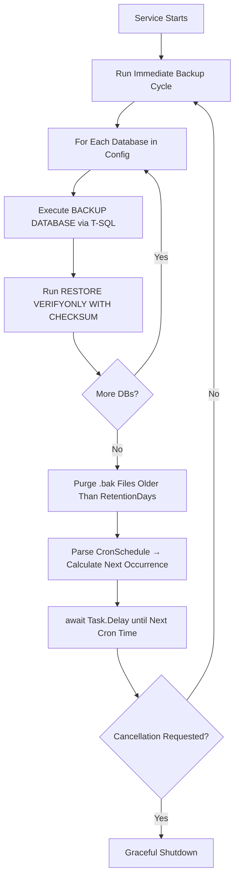

# 🗄️ DatabaseBackupService

A production-grade, automated SQL Server backup service built as a **.NET 10 Worker Service**. It runs as a Windows background service, executes full database backups on a configurable **Cron schedule**, verifies backup integrity with `RESTORE VERIFYONLY`, and automatically purges expired `.bak` files based on a retention policy.

---

## ✨ Features

- **Cron-based scheduling** — Uses [Cronos](https://github.com/HangfireIO/Cronos) for precise, standard 5-part cron expressions (e.g., `0 2,6,10 * * *`)
- **Immediate startup backup** — Runs a backup cycle the moment the service starts, then follows the cron schedule
- **Multiple database support** — Backs up any number of SQL Server databases in a single run
- **Backup integrity verification** — Automatically runs `RESTORE VERIFYONLY ... WITH CHECKSUM` after each backup
- **SQL injection safe** — Uses T-SQL `QUOTENAME` and `sp_executesql` with parameterized arguments
- **Compression support** — Optional `COMPRESSION` flag reduces disk usage
- **Automatic retention cleanup** — Deletes `.bak` files older than a configurable number of days
- **Dual-mode execution** — Runs as a Windows Service in production or a console app while debugging in Visual Studio
- **Hot-reload configuration** — Uses `IOptionsMonitor` so schedule/settings changes are picked up without restarting

---

## 🏗️ Architecture

```
DatabaseBackupService/
├── Program.cs               # Host builder: registers Windows Service, config, and worker
├── SqlBackupWorker.cs       # BackgroundService: cron loop, backup execution, retention cleanup
├── Model/
│   └── BackupOptions.cs     # Strongly-typed configuration model
├── appsettings.json         # Connection strings and BackupOptions section
└── Properties/
    └── launchSettings.json
```

### Key Components

| Component | Responsibility |
|---|---|
| `SqlBackupWorker` | Main hosted service; drives the cron loop and backup lifecycle |
| `BackupOptions` | Configuration model bound from `appsettings.json` |
| `RunBackupCycleAsync` | Iterates over configured databases and calls `BackupSingleDatabaseAsync` |
| `BackupSingleDatabaseAsync` | Executes `BACKUP DATABASE` + `RESTORE VERIFYONLY` via ADO.NET |
| `PurgeExpiredBackups` | Deletes `.bak` files older than `RetentionDays` |

---

## 🛠️ Tech Stack

| Package | Version | Purpose |
|---|---|---|
| `Microsoft.NET.Sdk.Worker` | .NET 10 | Worker Service host |
| `Microsoft.Data.SqlClient` | 7.1.1 | ADO.NET SQL Server driver |
| `Cronos` | 0.13.0 | Cron expression parsing & scheduling |
| `Microsoft.Extensions.Hosting.WindowsServices` | 10.0.14 | Windows Service lifetime support |
| `System.Security.Cryptography.Pkcs` | 10.0.14 | Cryptographic support |

---

## ⚙️ Configuration

All settings live in `appsettings.json` under the `BackupOptions` section:

```json
{
  "ConnectionStrings": {
    "MasterDatabase": "Server=localhost;Database=master;Trusted_Connection=True;TrustServerCertificate=True;"
  },
  "BackupOptions": {
    "Databases": [
      "MyDatabase1",
      "MyDatabase2"
    ],
    "BackupFolderPath": "D:\\SqlBackups",
    "CronSchedule": "0 2,6,10 * * *",
    "RetentionDays": 14,
    "CommandTimeoutSeconds": 3600,
    "UseCompression": true
  }
}
```

### Configuration Reference

| Setting | Type | Default | Description |
|---|---|---|---|
| `Databases` | `string[]` | `[]` | List of SQL Server database names to back up |
| `BackupFolderPath` | `string` | `""` | Absolute path where `.bak` files are written |
| `CronSchedule` | `string` | `"0 2,6,10 * * *"` | Standard 5-part cron expression for backup timing |
| `RetentionDays` | `int` | `14` | Days to keep backup files before auto-deletion |
| `CommandTimeoutSeconds` | `int` | `3600` | ADO.NET command timeout (seconds) for large DBs |
| `UseCompression` | `bool` | `true` | Enables SQL Server backup compression |

### Cron Expression Examples

| Expression | Schedule |
|---|---|
| `0 2 * * *` | Daily at 2:00 AM |
| `0 2,6,10,14,18,22 * * *` | Every 4 hours |
| `0 */6 * * *` | Every 6 hours |
| `0 2 * * 0` | Weekly, Sundays at 2:00 AM |

---

## 🚀 Getting Started

### Prerequisites

- [.NET 10 SDK](https://dotnet.microsoft.com/download)
- SQL Server (any edition) accessible via the configured connection string
- Write access granted to the `BackupFolderPath` for the SQL Server service account

### Run Locally (Debug)

```bash
dotnet run
```

The service will immediately run a backup cycle on startup, then follow the cron schedule. All output is written to the console.

### Publish & Deploy as a Windows Service

**1. Build and publish the release binary:**

```powershell
dotnet publish -c Release -o C:\Services\DatabaseBackupService
```

**2. Open an elevated (Administrator) PowerShell and register the service:**

```powershell
sc.exe create SqlDatabaseBackupService binPath= "C:\Services\DatabaseBackupService\DatabaseBackupService.exe" start= auto
sc.exe start SqlDatabaseBackupService
```

**3. Verify the service is running:**

```powershell
sc.exe query SqlDatabaseBackupService
```

Expected output includes `STATE : 4 RUNNING`.

---

## 🔐 Permissions Setup

### SQL Server Backup Folder Access

The `BACKUP DATABASE` command is executed by the **SQL Server Database Engine process**, not the .NET process. The backup folder must be writable by the SQL Server service account.

**Find your SQL Server service account:**

1. Press `Win + R`, type `services.msc`, press Enter
2. Locate **SQL Server (MSSQLSERVER)** or **SQL Server (SQLEXPRESS)**
3. Note the **Log On As** column (typically `NT SERVICE\MSSQLSERVER` or `NT SERVICE\MSSQL$SQLEXPRESS`)

**Grant folder permissions:**

1. Right-click your backup folder → **Properties** → **Security** → **Edit** → **Add**
2. Click **Locations...** and select your local computer (not the domain)
3. Enter the SQL Server service account name and click **Check Names**
4. Check **Allow: Modify** and click **Apply**

> [!IMPORTANT]
> If you skip this step, SQL Server will throw **Operating System Error 5 (Access is denied)** when it tries to write the `.bak` file — even if your personal Windows account has access to the folder.

### Windows Service Login Identity

When run via `sc.exe`, the service defaults to **Local System** (`NT AUTHORITY\SYSTEM`), which may not have SQL Server access when using `Trusted_Connection=True`.

**To fix this, set the service to run as your Windows user:**

1. Open `services.msc`, find **SqlDatabaseBackupService**, right-click → **Properties**
2. Go to the **Log On** tab
3. Select **This account** and enter `.\YourUsername` with your Windows password
4. Click **Apply** → **OK**, then restart the service

---

## 🔎 Verifying Backups

**Check backup history in SQL Server:**

```sql
SELECT TOP 100
    database_name,
    type,                 -- 'D' = Full, 'I' = Differential, 'L' = Log
    backup_start_date,
    backup_finish_date,
    is_copy_only
FROM msdb.dbo.backupset
ORDER BY backup_finish_date DESC;
```

**Test a backup manually in SSMS:**

Right-click your database → **Tasks** → **Back Up...** → set destination to your `BackupFolderPath` and confirm it completes without an access error.

---

## 📂 Backup File Naming

Each backup file is named using the pattern:

```
{DatabaseName}_Full_{yyyyMMdd_HHmmss}.bak
```

**Example:** `MyDatabase_Full_20261109_110000.bak`

---

## 🔄 Service Management Commands

```powershell
# Start the service
sc.exe start SqlDatabaseBackupService

# Stop the service
sc.exe stop SqlDatabaseBackupService

# Check service status
sc.exe query SqlDatabaseBackupService

# Remove the service (run as Administrator)
sc.exe delete SqlDatabaseBackupService
```

---

## 📋 How It Works



---

## 📄 License

This project is provided as-is for internal use.

